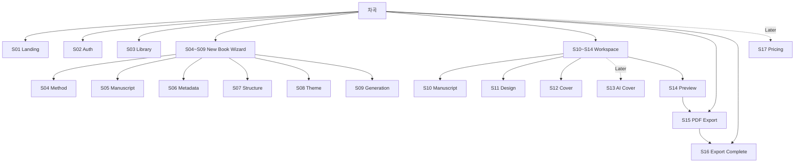

# 차곡 IA (Information Architecture)

- Product: 차곡 (Chagok)
- Document: Information Architecture
- Version: 1.0
- Status: CURRENT / IMPLEMENTATION BASELINE
- Updated: 2026-10-16
- Related: `_docs/TASK_FLOW.md`, `_docs/SCREEN_SPEC.md`, `_docs/FUNCTION_SPEC.md`
- Phase note: Phase 15A COMPLETE. `/` = Landing, `/library` = Library. Phase 15B Supabase Auth Runtime = HOLD. Phase 16 Ownership/DB/Storage/RLS = HOLD.

---

## 1. IA 목적

차곡의 화면·메뉴·라우트·주요 기능의 상하 관계를 정의한다.

Task Flow가 "사용자가 어떤 순서로 일을 완료하는가"를 정의한다면,
IA는 "서비스 안에 무엇이 어디에 존재하는가"를 정의한다.

핵심 제품 구조:

```text
차곡
├─ 랜딩
├─ 인증
├─ 내 서재
├─ 새 책 만들기
├─ 책 작업공간
│  ├─ 원고
│  ├─ 디자인
│  ├─ 표지
│  └─ 미리보기
└─ PDF 출력
```

---

## 2. Top-level IA



---

## 3. Global Navigation IA

### 3.1 비로그인 상태

```text
Landing
├─ 차곡 소개
├─ 핵심 가치
├─ 주요 기능
├─ 책 만들기 → Auth
└─ 로그인 → Auth
```

### 3.2 로그인 상태

```text
Landing
├─ 차곡 소개
├─ 새 책 만들기 → Wizard
└─ 내 서재 → Library

Library
├─ 책 목록
├─ 검색
├─ 상태 필터
├─ 정렬
├─ 새 책 만들기
├─ 휴지통
├─ 계정 상태
└─ 로그아웃
```

랜딩은 로그인 여부와 관계없이 서비스의 브랜드 진입점으로 유지한다.

로그인 상태에서는 CTA만 바뀐다.

---

## 4. Route IA

| Level | Area | Route | Screen | Auth |
|---|---|---|---|---|
| L1 | Landing | `/` | S01 | 불필요 |
| L1 | Auth | `/__auth` | S02 | 불필요 |
| L1 | Library | `/library` | S03 | Phase 16부터 필수 |
| L1 | New Book | `/__wizard` | S04~S09 | Phase 16부터 필수 |
| L1 | Workspace | `/__workspace?file=...` | S10~S14 | Phase 16부터 필수 |
| L2 | PDF API | `/__pdf?file=...` | S15 | Phase 16부터 ownership 검사 |
| L2 | Export Complete | Workspace 내부 상태 | S16 | Workspace와 동일 |
| Later | Pricing | TBD | S17 | 선택 |

### Phase 15A / HOLD

Phase 15A는 Entry Routing + Local/Guest fallback까지 완료했다.

현재:
- Local mode에서 로그인 없이 Library / Wizard / Workspace 사용 가능
- Configured Auth UI foundation은 유지
- 사용자별 책 소유권은 없음
- Library / Wizard / Workspace 강제 로그인 차단은 아직 최종 보안 경계가 아님

Phase 15B Supabase Auth Runtime과 Phase 16 Ownership/DB/Storage/RLS는 HOLD다.

---

## 5. Landing IA — S01

```text
S01 Landing
├─ Header
│  ├─ 차곡 로고
│  ├─ 로그인 / 내 서재
│  └─ 새 책 만들기
│
├─ Hero
│  ├─ 핵심 메시지
│  ├─ 제품 설명
│  └─ Primary CTA
│
├─ How it works
│  ├─ 원고
│  ├─ 구조
│  ├─ 디자인
│  ├─ 표지
│  └─ PDF
│
├─ Product Preview
│  ├─ Library
│  ├─ Workspace
│  └─ Preview
│
└─ Footer
   └─ 기본 서비스 정보
```

MVP에서는 랜딩을 과도하게 키우지 않는다.

필수 목적:
1. 차곡이 무엇인지 이해
2. 새 책 만들기 시작
3. 기존 사용자는 내 서재 진입

---

## 6. Auth IA — S02

```text
S02 Auth
├─ 차곡 브랜드
├─ 로그인 탭
│  ├─ 이메일
│  ├─ 비밀번호
│  └─ 로그인
│
├─ 회원가입 탭
│  ├─ 이메일
│  ├─ 비밀번호
│  └─ 계정 만들기
│
├─ 상태 메시지
└─ 서재/랜딩 복귀
```

Auth 완료 후:
- `returnTo` 가 있으면 해당 내부 경로
- 없으면 `/library`

외부 URL redirect는 허용하지 않는다.

---

## 7. Library IA — S03

```text
S03 Library
├─ Header
│  ├─ 차곡
│  ├─ 검색
│  ├─ 새 책 만들기
│  ├─ 사용자 이메일
│  └─ 로그아웃
│
├─ Filter / Sort
│  ├─ 전체
│  ├─ 초안
│  ├─ 검토 중
│  ├─ 완료
│  └─ 정렬
│
├─ Book Grid
│  └─ Book Card
│     ├─ 표지
│     ├─ 제목
│     ├─ 저자
│     ├─ 상태
│     ├─ 수정일
│     ├─ 열기 · 편집
│     ├─ PDF 받기
│     └─ More
│        ├─ 책 정보·표지 편집
│        ├─ 사본 만들기
│        └─ 휴지통으로 이동
│
├─ 새 책 카드
└─ 휴지통
   ├─ 복구
   └─ 영구 삭제
```

Library는 작업 허브이며 Landing 역할을 하지 않는다.

---

## 8. New Book Wizard IA — S04~S09

```text
New Book Wizard
├─ S04 시작 방식
│  ├─ 원고 가져오기
│  └─ 빈 책 시작
│
├─ S05 원고 입력
│  ├─ 파일 업로드
│  │  ├─ TXT
│  │  ├─ MD
│  │  ├─ PDF
│  │  └─ DOCX
│  └─ 텍스트 붙여넣기
│
├─ S06 책 기본정보
│  ├─ 제목
│  ├─ 부제
│  └─ 저자
│
├─ S07 구조 확인
│  ├─ Part
│  ├─ Chapter
│  ├─ Section
│  ├─ 순서 변경
│  ├─ 추가
│  └─ 삭제
│
├─ S08 디자인 선택
│  ├─ Practical
│  └─ Minimal
│
└─ S09 책 생성
   ├─ 원고 확인
   ├─ 책 틀 생성
   ├─ 구조 반영
   ├─ 정보 반영
   └─ 디자인 적용
```

### Wizard 분기

원고 가져오기:

```text
S04 → S05 → S06 → S07 → S08 → S09
```

빈 책:

```text
S04 → S06 → S08 → S09
```

---

## 9. Workspace IA — S10~S14

```text
Workspace
├─ Global Header
│  ├─ 내 서재
│  ├─ 책 제목
│  ├─ 저장 상태
│  ├─ 저장
│  └─ PDF 만들기
│
├─ 원고 / S10
│  ├─ Editor
│  ├─ 본문 편집
│  ├─ 구조 편집
│  ├─ 저장
│  └─ Autosave / Recovery
│
├─ 디자인 / S11
│  ├─ Practical
│  ├─ Minimal
│  ├─ 본문 글자 크기
│  ├─ 행간
│  └─ 쪽 여백
│
├─ 표지 / S12
│  ├─ 표지 이미지
│  ├─ 제목
│  ├─ 부제
│  ├─ 저자
│  └─ 배경색
│
├─ AI 표지 / S13 [Later]
│
└─ 미리보기 / S14
   ├─ Single
   ├─ Spread
   └─ Grid
```

Workspace는 하나의 책에 대한 모든 편집 기능을 묶는 작업 셸이다.

기존 Editor / Viewer / PDF 엔진은 Workspace 안에서 KEEP / WRAP 한다.

---

## 10. PDF / Export IA — S15~S16

```text
S15 PDF Export
├─ 전자책 PDF 만들기
├─ 생성 상태
└─ 오류 / 재시도

S16 Export Complete
├─ 완료 메시지
├─ 파일명
├─ PDF 다운로드
├─ 책으로 돌아가기
└─ 다시 만들기
```

MVP UI에서 숨길 수 있는 고급 기능:
- Print
- EPUB
- Web ZIP
- 기타 고급 Export

코드는 삭제하지 않는다.

---

## 11. Recovery IA

### Wizard Recovery

```text
Wizard Draft
├─ 이어서 하기
└─ 새로 시작
```

### Editor Recovery

```text
Editor Recovery
├─ 복구
└─ 현재 서버본 사용
```

Recovery는 별도 L1 메뉴가 아니라 해당 작업 Context에 종속된 상태 UI다.

---

## 12. Information Objects

차곡의 주요 정보 객체:

```text
User
└─ Book
   ├─ Metadata
   │  ├─ title
   │  ├─ subtitle
   │  ├─ author
   │  ├─ status
   │  └─ tags
   │
   ├─ Content
   │  └─ book.html [Content SoT]
   │
   ├─ Theme
   │  └─ book.css
   │
   ├─ Cover
   │  └─ sidecar image state
   │
   ├─ History
   ├─ Recovery
   └─ Export
      └─ PDF
```

현재 로컬 MVP에서는 User → Book ownership이 없다.

Phase 16에서:

```text
User
└─ owns
   └─ Book
```

관계를 실제 보안 경계로 구현한다.

---

## 13. Navigation Rules

### Global

- Landing → Auth / Library / Wizard
- Library → Wizard / Workspace
- Wizard 완료 → Workspace
- Workspace → Library
- Workspace → PDF
- PDF 완료 → Workspace

### Back

- Wizard: 직전 Step
- Workspace: Library
- Auth: Landing
- PDF 실패: Workspace

### Cancel

Wizard 취소:
- Library 복귀
- 확정 전 새 책 폴더 생성 금지

---

## 14. Screen Hierarchy

| Level | Screen | 역할 |
|---|---|---|
| L0 | 차곡 | Product Root |
| L1 | S01 Landing | 브랜드/진입 |
| L1 | S02 Auth | 계정 진입 |
| L1 | S03 Library | 책 관리 허브 |
| L1 | S04~S09 Wizard | 새 책 생성 |
| L1 | S10~S14 Workspace | 책 제작 |
| L1 | S15~S16 Export | 결과물 생성 |
| Later | S17 Pricing | 요금 |
| Later | S13 AI Cover | AI 표지 |

---

## 15. Phase 15 IA Impact

Phase 15A Entry Routing은 구현 완료됐다.

### Current (= Target)

```text
/ → Landing
/library → Library
/__auth → Auth / Local fallback
/__wizard → Wizard
/__workspace → Workspace
```

완료된 정렬:

1. Landing 화면
2. `GET /` → Landing
3. `GET /library` → Library
4. Auth 성공 → `returnTo` 또는 `/library` (Configured mode)
5. Local mode → Auth 강제 없이 Wizard/Library 사용
6. Workspace의 "내 서재" → `/library`
7. Wizard 취소/복귀 → `/library`

HOLD:

- Phase 15B Supabase Auth Runtime
- Phase 16 Ownership / DB / Storage / RLS

---

## 16. DO NOT BREAK

IA 변경 시 아래는 구조 변경 대상이 아니다.

- `book.html` Content Source of Truth
- Paged.js
- 기존 Editor
- 기존 Viewer
- PDF Engine
- Theme Engine
- Cover sidecar
- Wizard Draft Recovery
- Editor Autosave / Recovery
- 보호 책
- 역사적 Audit / Release Gate 기록

---

## 17. Current IA Baseline

```text
차곡
│
├─ Landing /
│  ├─ 로그인
│  ├─ 새 책 만들기
│  └─ 내 서재 (로그인 상태)
│
├─ Auth /__auth
│
├─ Library /library
│  ├─ Search / Filter / Sort
│  ├─ Book Cards
│  ├─ New Book
│  └─ Trash
│
├─ New Book /__wizard
│  ├─ Method
│  ├─ Manuscript
│  ├─ Metadata
│  ├─ Structure
│  ├─ Theme
│  └─ Generate
│
├─ Workspace /__workspace
│  ├─ Manuscript
│  ├─ Design
│  ├─ Cover
│  └─ Preview
│
└─ Export
   ├─ PDF
   └─ Complete
```

이 구조를 차곡의 현재 IA 기준으로 사용한다.
